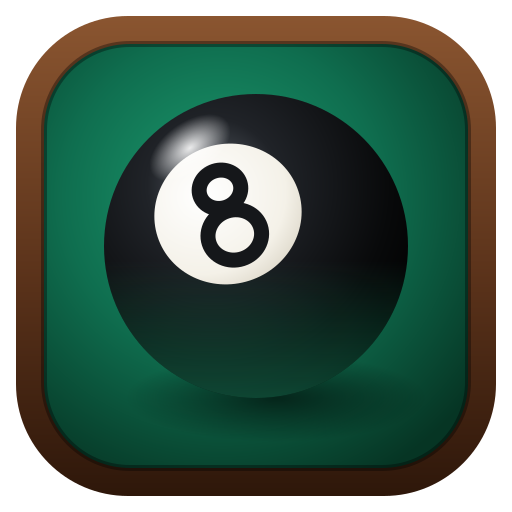

# Billard

Eight-ball against a computer opponent or a second player at the same screen, written in JavaFX 21 (Java 21+).

**Version 1.0.0.** See [CHANGELOG.md](CHANGELOG.md) for what each release added.

## Features

- Play against a bot, or two players taking turns on one screen
- Eight-ball rules with groups, fouls and ball in hand
- Ball physics with rolling, sliding and cushion bounces, plus cue-ball spin (draw, follow and side)
- Aim lock, a guide line and a power bar for precise shots
- A realistic table: cloth texture, wood rails, balls that visibly roll and drop into the pockets
- Recorded ball, cushion and pocket sounds, and lounge jazz background music, each with its own volume
- Full-screen mode and a window that scales from small laptops up to large monitors

## Opponents

Pick an opponent on the title screen:

- **Play vs bot**: you are Player 1 and break; the bot plays as Player 2. On its turn it thinks for a moment,
  places the cue ball if it has ball in hand, swings the cue onto its line and shoots. While it plays, the table,
  the power bar and the spin button ignore input; Settings, Menu and New match keep working.
- **Two players**: two people take turns at the same mouse and keyboard, as Player 1 and Player 2.

**New match** and **Play again** keep the opponent you chose; go back to the menu to switch.

### How the bot plays

The bot (`ShotPlanner` in `com.example.billard.model`) tries its shots out before playing one. It lists pots of
every ball it may legally hit into every pocket, at several powers and with centre, draw or follow spin, plus a
ring of plain shots all round the cue ball for when no pot is on. With ball in hand it also tries spots straight
behind each of its balls. Each candidate is played forward on a copy of the table with the game's own physics and
judged by the game's own rules, so it sees scratches, fouls and an early 8-ball exactly as the match would. It
prefers shots that win, then shots that keep the table with an easy next shot, then safeties that leave you
nothing easy. The best few are checked again with the aim slightly off, so it favours shots with room for error.
Finally its aim and power get a small random error, so it misses long and thin shots now and then, like a solid
club player.

Planning runs on a background thread from a snapshot of the table, typically in well under a fifth of a second,
so the game never stutters while the bot thinks.

## Run

```
./mvnw javafx:run
```

## Test

```
./mvnw test
```

The rules, physics, turn cycle and the bot's shot planner live in `com.example.billard.model`, which has no
JavaFX dependency and is covered by unit tests. Further tests guard the UI state, the audio mixer, and the source files
themselves (ASCII only, at most 120 columns per line).

## Package

```
./mvnw javafx:jlink
```

builds a self-contained runtime image in `target/billard`, started with `target/billard/bin/billard`.

## Controls

| Action | Input |
| :--- | :--- |
| Aim | Mouse, or `←` `→` (hold `Shift` for fine steps) |
| Lock / unlock aim | Right click |
| Power | Mouse wheel, `↑` `↓`, or click the power bar |
| Spin | `Spin` button, then click or drag on the cue ball, or use the arrow keys; `Centre` resets it |
| Shoot | Left click, `Space` or `Enter` |
| Place the cue ball (after a foul) | Mouse or arrow keys, then click or `Enter` |
| Full screen on / off | `F` |
| Close the spin picker or settings | `Esc` |

Against the bot these controls work on your turns only.

## Rules

Simplified standard eight-ball. The first ball potted on the open table decides each player's group
(solids or stripes). Clear your group, then pot the 8-ball to win; pot it early, or foul while potting
it, and you lose. A foul gives your opponent ball in hand: scratching, hitting the wrong ball first,
hitting nothing, or a shot where nothing is potted and no ball reaches a cushion. If the 8-ball drops on
the break it is re-spotted.

Not modelled: jump shots, called pockets, kitchen restriction on the break.

## Settings

Sound effect and music volumes are set on the Settings page (from the menu or during a match) and are
remembered between sessions through Java Preferences.

## Logo

The 8-ball logo is drawn in `logo/`: `billard.svg` for 48 px and up, `billard-small.svg` for 24 and 32 px,
and `billard-tiny.svg`, snapped to whole pixels, for 16 px. `logo/billard.ico` is the Windows icon for
installers and shortcuts, and `.idea/icon.svg` is the project icon in IntelliJ. After changing an SVG, run

```
python logo/render_icons.py
```

which uses headless Chrome or Edge to redraw the PNG window icons in
`src/main/resources/com/example/billard/icon/` and the `.ico` (needs Pillow).

## Credits

- Music: five lounge jazz tracks by Kevin MacLeod (incompetech.com), licensed under Creative Commons
  Attribution 4.0. Details and the changes made are in
  [`music/README.md`](src/main/resources/com/example/billard/music/README.md).
- Sound effects: CC0 recordings from Freesound, listed per file in
  [`sounds/README.md`](src/main/resources/com/example/billard/sounds/README.md). No game-over fanfare
  ships yet; drop a `success_1.wav` into that folder to add one.

## Licence

The code is released under the [MIT License](LICENSE). The bundled music and sounds keep their own
licences, listed above and in `LICENSE`.
